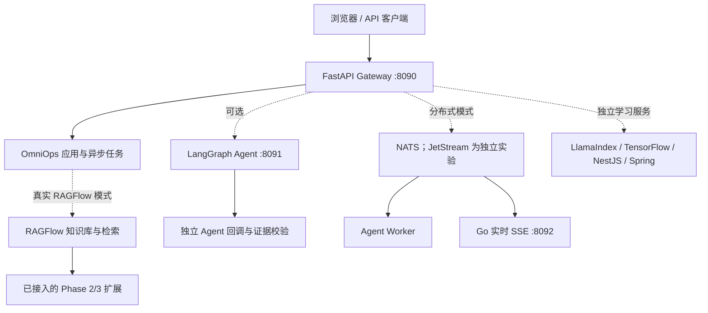

# OmniForge AI

**OmniForge AI** 是基于 [RAGFlow v0.27.2](https://github.com/infiniflow/ragflow) 的个人 RAG 与 Agent 研究扩展项目，包含 **OmniRAG-Agent** 检索与治理扩展、**OmniOps Copilot** 事件分析演示应用，以及 **OmniAI Modular Platform V2** 的模块化服务与学习实验。个人扩展主要集中在查询自适应混合检索、视觉侧索引与融合、规则式证据校验，以及有界 Agent 和只读工具治理模块。

**当前定位为持续开发与验证中的研究原型。** Phase 2 自适应检索与 Phase 3 视觉/校验扩展已进入部分 RAGFlow 主链路；Phase 4/5 的 Agent、记忆、工具治理模块及补丁已提供，原生入口的完整接入仍待完成。真实 RAG 质量实验仍记录为 `not_run`，本仓库暂不提供性能提升、通用自主处置或生产可用性的结论。详见[实现状态](#实现状态与个人扩展边界)及[验证状态](#验证状态与复现原则)。

> **命名说明**：OmniForge AI 是本 GitHub 仓库的名称；代码中沿用 `OmniAI`、`OmniRAG` 和 `OmniOps` 命名，分别指模块化集成层、研究扩展层和产品应用层。上游 RAGFlow 的原始说明保留在 [RAGFLOW_README.md](RAGFLOW_README.md)。

## 目录

- [实现状态与个人扩展边界](#实现状态与个人扩展边界)
- [项目组成](#项目组成)
- [系统架构](#系统架构)
- [功能与代码位置](#功能与代码位置)
- [快速开始](#快速开始)
- [Docker 模块化运行](#docker-模块化运行)
- [接入真实 RAGFlow](#接入真实-ragflow)
- [学习路线](#学习路线)
- [验证状态与复现原则](#验证状态与复现原则)
- [数据、安全与许可](#数据安全与许可)

## 实现状态与个人扩展边界

以下状态于 **2026-10-15** 核对，对应功能源码快照 `4a4b051d8fa4db3635c8276681188e1890f6b4fe`；文档修订本身不代表完成了新的运行验证。

| 范围 | 当前公开实现 | 尚未完成的验证或接入 |
| --- | --- | --- |
| 上游 RAGFlow | 文档解析、分块、Embedding/模型适配、知识库、基础混合检索、引用、Canvas、Memory 与 MCP | 这些主要继承上游，不能计为个人从零实现 |
| Phase 2 自适应检索 | 根据查询特征分别调整候选召回与最终排序权重、候选池；`rag/nlp/search.py` 已有可开关 hook | 人工规则与权重仍需固定基线、消融实验和真实质量评测 |
| Phase 3 多模态与证据校验 | SigLIP2 适配、JSONL 视觉侧索引、加权 RRF、原图读取及规则式证据校验；普通 `async_chat()` 已有 hook | 真实索引、图文问答效果和原生 Agent 原图闭环仍待验证；HashEncoder 仅用于测试 |
| Phase 4/5 Agent、记忆与工具 | 有界补查、防循环、策略记忆、工具短名单、参数校验、调用预算、审计及 TaskSpec 编译模块/补丁 | 当前原生 `agentic_rag.py`、`agent_with_tools.py` 尚未见对应治理 hook，不能视为全部接入 |
| OmniOps 应用 | 事件、聊天、证据、轨迹、文件暂存和可选 RAGFlow HTTP 接入 | demo 使用模板答案，部分查询/补查为模拟；上传是暂存，不自动完成解析入库 |
| 独立 LangGraph 服务 | `StateGraph` 编排分类、检索、工具、生成、校验和有限重试 | 检索主要读取事件已存证据，工具结果尚未完整进入生成上下文；不能据此推定端到端自主处置 |
| 网关与服务集成 | FastAPI、202 异步任务、SSE、限流、幂等入口、可选 NATS 和独立框架服务 | 任务状态主要在进程内，持久恢复、多网关一致性及生产认证边界仍需补齐 |
| 路由训练与质量评测 | LoRA/QLoRA 脚本、小型合成数据、规则基线和离线 smoke 产物 | 真实 RAG、学习路由保护集比较与晋升尚未完成；不能据此声称训练收益 |

源码归属及调用链见 [SOURCE_MAP](docs/omnirag/SOURCE_MAP.md)。该文档保存了 Phase 1 的“保护未改动基线”约定；当前版本已合入 Phase 2/3 hook，因此不能继续把当前检索和聊天文件描述为 `frozen_unmodified`。实际接入以 [检索入口](rag/nlp/search.py)、[聊天入口](api/db/services/dialog_service.py)及对应阶段代码为准。

## 项目组成

| 层次 | 职责 | 入口 |
| --- | --- | --- |
| RAGFlow 0.27.2 | 文档解析、知识库、检索运行时、模型接入及原生 UI/API | [上游说明](RAGFLOW_README.md)、`api/`、`rag/`、`web/` |
| OmniRAG-Agent | 自适应检索、视觉检索、证据校验、Agent 治理、工具策略与评测方案 | [OmniRAG 概览](OMNIRAG.md)、`extensions/omnirag/`、`docs/omnirag/` |
| OmniOps Copilot | 面向事件与设备的应用流程、证据展示和演示数据 | `apps/omniops/`、[产品说明](OMNIOPS.md) |
| OmniAI Modular Platform V2 | FastAPI 网关、LangGraph Agent、异步任务和独立学习服务 | [OmniAI 概览](OMNIAI.md)、`services/`、`omniai_platform/` |
| 学习与实验 | 15 篇专题笔记、框架实验、基准脚本和部署示例 | `docs/learning/`、`labs/`、`benchmarks/`、`infra/omniai/` |

**归属边界**：RAGFlow 上游负责其原有的解析、存储、检索、Agent Canvas、MCP 接入及基础设施；OmniRAG 和 OmniAI 是在此基础上的扩展与集成。各组件的复用依据见[上游组件说明](docs/omniai/UPSTREAM_COMPONENTS.md)和[复用决策](docs/omniai/GITHUB_REUSE_DECISIONS.md)。

## 系统架构



网关负责 HTTP 接入、OpenAPI、请求标识、限流、并发边界、幂等请求和异步任务接口。Agent、索引与模型服务保持独立依赖环境，避免把不同框架的依赖强行放进 RAGFlow 的 Python 环境。任务后端可以使用本地实现或 NATS；两者的任务状态仍主要保存在进程内，当前不能由 NATS 分发推定已具备持久恢复。详细设计见[架构文档](docs/omniai/ARCHITECTURE.md)与[集成报告](docs/omniai/INTEGRATION_REPORT.md)。

## 功能与代码位置

| 主题 | 内容 | 主要位置 |
| --- | --- | --- |
| 检索与多模态 | 固定基线、自适应混合检索、视觉侧索引、融合与证据验证 | `extensions/omnirag/`、`rag/nlp/search.py`、`docs/omnirag/` |
| Agent 编排 | 分类、检索、工具、生成、验证与有界重试 | `services/omniai_agent/`、`extensions/omnirag/agent/` |
| API 网关 | OmniOps API、异步作业、SSE、限流和指标 | `services/omniai_gateway/`、`omniai_platform/` |
| 工具与 MCP | 只读工具、工具选择策略、MCP 示例 | `extensions/omnirag/`、`scripts/omniai/mcp_app.py` |
| 向量与索引 | 余弦检索、Milvus Lite、LlamaIndex 对比实验 | `labs/vector_lab/`、`services/omniai_llamaindex/` |
| 模型与训练 | Transformers/LoRA 路由研究、TensorFlow/Keras 实验 | `labs/tensorflow_lab/`、`services/omniai_tensorflow/`、`docs/omnirag/` |
| 分布式与多语言 | NATS、Go SSE、NestJS BFF、Spring Boot 连接器 | `services/omniai_realtime_go/`、`services/omniai_bff_nest/`、`services/omniai_enterprise_spring/` |
| 部署与观测 | Compose profiles、Prometheus 配置和验证脚本 | `infra/omniai/`、`scripts/omniai/` |

各服务可以分别学习和验证。LangChain/LCEL、LlamaIndex、Milvus Lite、TensorFlow 等独立学习模块，尚不能直接视为 RAGFlow 主链路已经接入的组件。证据校验属于词项、数字和否定信号驱动的启发式规则，其 confidence 是规则分数；运行某个实验模块，也不自动证明整个系统的吞吐量、召回质量或生产稳定性。

## 快速开始

准备 Git 和 Python 3.13，并在希望保存项目与数据的位置克隆仓库。下面使用仓库内的 `.venv` 和 `.local-data` 目录；两者均已加入 `.gitignore`。演示模式不要求先启动 RAGFlow。

```bash
git clone https://github.com/ytt070666/OmniForge-AI.git
cd OmniForge-AI
python -m venv .venv
```

Windows PowerShell：

```powershell
$python = Join-Path (Get-Location) '.venv\Scripts\python.exe'
$env:OMNIOPS_MODE = 'demo'
$env:OMNIOPS_DATA_ROOT = Join-Path (Get-Location) '.local-data'
& $python -m pip install -r services/omniai_gateway/requirements.txt
& $python scripts/omnirag/run_omniops.py
```

Linux/macOS：

```bash
source .venv/bin/activate
export OMNIOPS_MODE=demo
export OMNIOPS_DATA_ROOT="$(pwd)/.local-data"
python -m pip install -r services/omniai_gateway/requirements.txt
python scripts/omnirag/run_omniops.py
```

需要镜像时，可将 pip 安装命令加上 `-i https://pypi.tuna.tsinghua.edu.cn/simple`。网关运行后可访问：

| 地址 | 用途 |
| --- | --- |
| `http://127.0.0.1:8090/` | OmniOps 页面 |
| `http://127.0.0.1:8090/docs` | OpenAPI 文档 |
| `http://127.0.0.1:8090/api/v1/health` | 健康检查 |
| `http://127.0.0.1:8090/api/v1/platform/modules` | 模块注册信息 |

Agent、LlamaIndex 和 TensorFlow 使用各自的依赖环境，安装要求见相应的 `requirements.txt`。本机管理脚本 `scripts/omniai/dev.ps1` 可通过 `OMNIAI_RUNTIME_ROOT` 指向自选的运行目录；未设置时使用仓库中的 `.runtime`（已忽略）。

## Docker 模块化运行

`infra/omniai/docker-compose.yml` 将网关与可选服务拆成 profile。运行前请确认 Docker 的镜像、卷和资源配置符合本机需求；构建与启动会下载镜像并创建本地数据。

```powershell
# 从仓库根目录运行网关
docker compose -f infra/omniai/docker-compose.yml --profile core up --build gateway
```

| Profile | 可选组件 | 常用端口 |
| --- | --- | --- |
| `core` | FastAPI Gateway | 8090 |
| `agent` | LangGraph Agent | 8091 |
| `rag` | LlamaIndex 对比服务 | 8094 |
| `distributed` | NATS、Agent Worker、Go 实时服务 | 4222、8092 |
| `polyglot` | NestJS BFF、Spring Boot 连接器 | 8093、8096 |
| `ml` | TensorFlow 服务 | 8095 |
| `observability` | Prometheus | 9090 |

这些 profile 是组合与学习入口，依赖的模型、数据、凭据以及实际资源需求需在目标环境另行配置。编排文件中的服务、环境变量与端口以[Compose 文件](infra/omniai/docker-compose.yml)为准。

## 接入真实 RAGFlow

演示模式只用于检验应用交互和接口。要使用真实知识库，先按[RAGFlow 上游说明](RAGFLOW_README.md)准备 RAGFlow v0.27.2，确认后端 API、文档解析、嵌入模型和知识库可用，再通过环境变量配置 `OMNIOPS_MODE=ragflow`、`OMNIOPS_RAGFLOW_API_ROOT`、`OMNIOPS_RAGFLOW_API_KEY` 与 `OMNIOPS_RAGFLOW_CHAT_ID`。变量示例见 [`infra/omniai/.env.example`](infra/omniai/.env.example)；真实凭据不要提交到仓库。

如要对比 OmniRAG 扩展，请参考[本地执行顺序](docs/omnirag/FINAL_LOCAL_EXECUTION_PLAN.md)与 [Phase 1 基线流程](docs/omnirag/PHASE1_RUNTIME_BASELINE.md)，但先核对文档所针对的阶段。当前快照已包含 Phase 2/3 核心改动，不能直接作为“纯上游、未修改”对照；应单独保留上游基线及数据、模型和配置，再分别验证扩展。各阶段结果单独归档，静态检查不替代真实质量实验。

## 学习路线

建议先读[完整学习路径](docs/omniai/LEARNING_PATH.md)，再按下表选择实验。`docs/learning/` 提供 15 篇中文专题笔记。

| 阶段 | 建议顺序 | 对应内容 |
| --- | --- | --- |
| 基础 | 大模型与 Transformers → 向量检索 → RAG | [01 模型](docs/learning/01_llm_transformers.md)、[02 向量](docs/learning/02_vector_search.md)、[03 RAG](docs/learning/03_rag.md) |
| 编排 | LangChain → LangGraph → LlamaIndex → FastAPI | [04 LangChain](docs/learning/04_langchain.md)、[05 LangGraph](docs/learning/05_langgraph.md)、[06 LlamaIndex](docs/learning/06_llamaindex.md)、[07 FastAPI](docs/learning/07_fastapi.md) |
| 工程 | NATS → Go → NestJS → Spring → TensorFlow | [08 分布式](docs/learning/08_distributed_nats.md)、[09 Go](docs/learning/09_go.md)、[10 NestJS](docs/learning/10_node_nestjs.md)、[11 Spring](docs/learning/11_java_spring.md)、[12 TensorFlow](docs/learning/12_tensorflow.md) |
| 集成 | MCP/函数调用 → 可观测性 → Docker 微服务 | [13 MCP](docs/learning/13_mcp_function_calling.md)、[14 可观测性](docs/learning/14_observability.md)、[15 部署](docs/learning/15_docker_microservices.md) |

学习时可以先运行 `labs/` 中的独立示例，再追踪 `services/` 中的实现，最后阅读 `docs/omnirag/` 的阶段设计与评测方案。

## 验证状态与复现原则

1. **公开质量实验仍未完成。** [评估矩阵](artifacts/omnirag/phase6/evaluation_matrix.json)将真实 RAGFlow 基线、自适应检索、多模态检索、学习路由测试/保护集及真实系统观测记录为 `not_run`。小规模合成工具 smoke 和规则路由基线是离线检查，不是企业问答准确率、模型训练收益或生产质量指标。
2. **V2 本地运行说明与公开证据分开阅读。** [集成报告](docs/omniai/INTEGRATION_REPORT.md)记载曾运行独立服务、Compose、基础模型推理与隔离 LoRA/QLoRA 合成训练，并明确适配器尚未通过保护集晋升、未接入产品。其引用的 `artifacts/runtime/FINAL_RUNTIME_REPORT.md` 不在当前公开快照中，相关原始运行报告也未随仓库提供；因此这些记录尚不能由仓库读者独立复核。
3. **当前公开 CI 尚未通过。** 截至 2026-10-15，[OmniRAG CI 运行 36956925629](https://github.com/ytt070666/OmniForge-AI/actions/runs/36956925629)的 `static-contracts` 失败：[日志](https://github.com/ytt070666/OmniForge-AI/actions/runs/36956925629/job/110681845045)显示 Phase 1 哈希门禁发现 `rag/nlp/search.py` 与 `api/db/services/dialog_service.py` 已偏离原始基线，后续容器构建被跳过。这与当前已存在的 Phase 2/3 hook 对应；应区分纯基线与扩展版本并更新门禁，不能把当前哈希覆盖成“未修改基线”来掩盖差异。
4. **历史状态文件存在阶段差异。** [早期发布状态](artifacts/omnirag/phase8/final_release_status.json)中的 `static_validation=pass`、`core_baseline=frozen_unmodified` 是早期 pre-local 记录，不适用于当前已修改核心文件的快照，也不能覆盖当前公开 CI 的失败结论。
5. **演示与真实调用分别标注。** OmniOps demo 使用确定性答案，`retrieve_more` 等部分步骤是模拟；真实 RAGFlow 调用失败也可降级为演示结果。请结合响应中的 mode/degraded、执行轨迹和模型配置判断本次使用了哪条路径。独立服务中的 MockEmbedding、合成分类模型等也不代表真实语义质量。
6. **重新验证需要保留原始证据。** 记录提交、依赖、数据划分、模型、配置和完整输出；在条件一致时比较 Recall@K、MRR、NDCG、引用支持与延迟。原始报告公开前应删除凭据和本机标识。没有产物的检查继续标注 `not_run`。
7. 若已有与 `scripts/omniai/dev.ps1` 约定一致的独立环境，可以运行 `powershell -File scripts/omniai/dev.ps1 validate` 执行验证脚本。该命令会运行自检并可能生成本地清单；使用前请查看脚本、依赖和上述哈希门禁问题。

本 README 修正的是功能归属和证据表述。尚未合入的本地实验、未公开运行报告，以及没有对应数据的性能结论均未作为已验证成果；目标环境的功能、质量、性能与安全验证仍需分别完成。

## 数据、安全与许可

请把 API 密钥、密码、模型文件、知识库数据、运行日志和基准输出留在仓库外的本机目录。`.gitignore` 已排除常见的环境文件、运行报告和本机基准结果；新增文件提交前仍需自行检查内容。示例变量放在 `.env.example` 中，不包含真实凭据。

本仓库保留了 RAGFlow 的原始版权与许可文件：[LICENSE](LICENSE)。依赖及其他来源见[第三方说明](THIRD_PARTY_OMNIAI.md)和[上游组件清单](config/omniai/upstreams.json)。如需分发构建产物，请继续保留实际包含的第三方许可声明。
